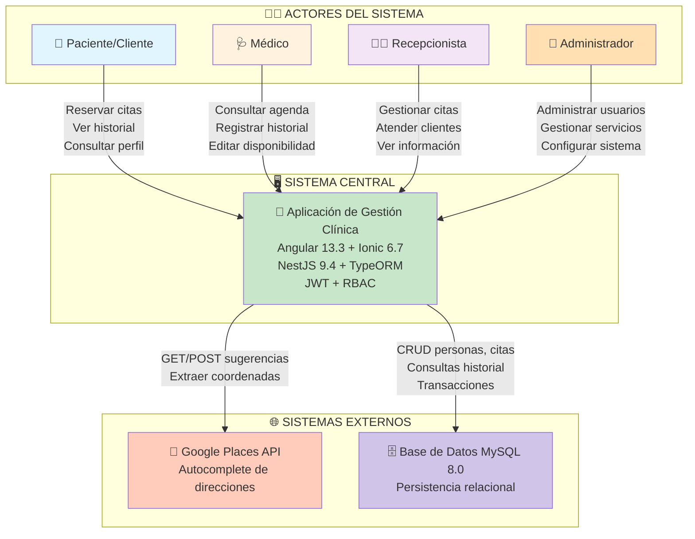

# Diagrama de Contexto - Sistema de Gestión de Clínicas

## Código Mermaid (para draw.io, Lucidchart, o convertir a PNG/SVG)

## Cómo usar este diagrama:

### Opción 1: Convertir a Imagen (Recomendado)
1. Copia el código Mermaid arriba
2. Ve a https://mermaid.live/
3. Pega el código
4. Exporta como PNG/SVG
5. Inserta en Word/PDF

### Opción 2: Usar en draw.io
1. Ve a https://draw.io/
2. File → New → Blank Diagram
3. Extensions → Mermaid
4. Pega el código

### Opción 3: Usar en Lucidchart
1. Lucidchart soporta Mermaid nativamente
2. Crea diagrama nuevo
3. Pega el código

## Elementos del Diagrama

| Elemento | Descripción |
|----------|-------------|
| **Paciente/Cliente** | Accede a reservar citas, ver historial, consultar perfil |
| **Médico** | Consulta agenda, registra historial clínico, edita disponibilidad |
| **Recepcionista** | Gestiona citas, atiende clientes, visualiza información |
| **Administrador** | Administra usuarios, gestiona servicios, configura el sistema |
| **App Central** | Sistema web Angular + Ionic (frontend) y NestJS (backend) |
| **Google Places API** | Proporciona autocompletado de direcciones y geolocalización |
| **MySQL 8.0** | Base de datos relacional que almacena toda la información |

## Nota para la Memoria

Este diagrama debe insertarse en la sección **6.1 Diagrama de Contexto** de la memoria, reemplazando el texto "[PENDIENTE DE FIGURA]".
